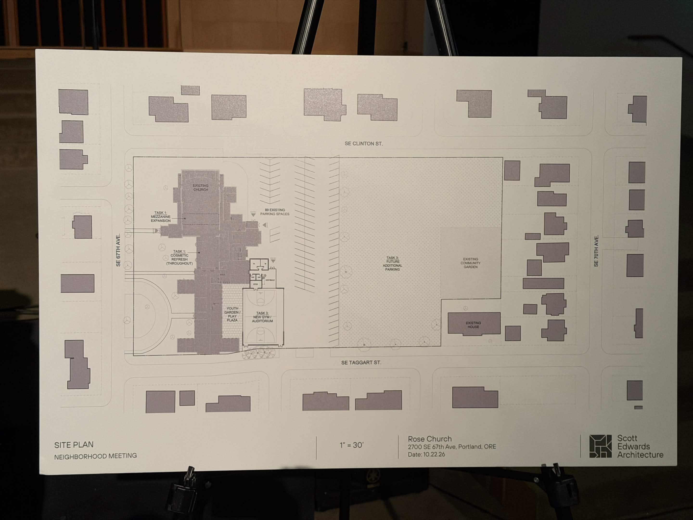
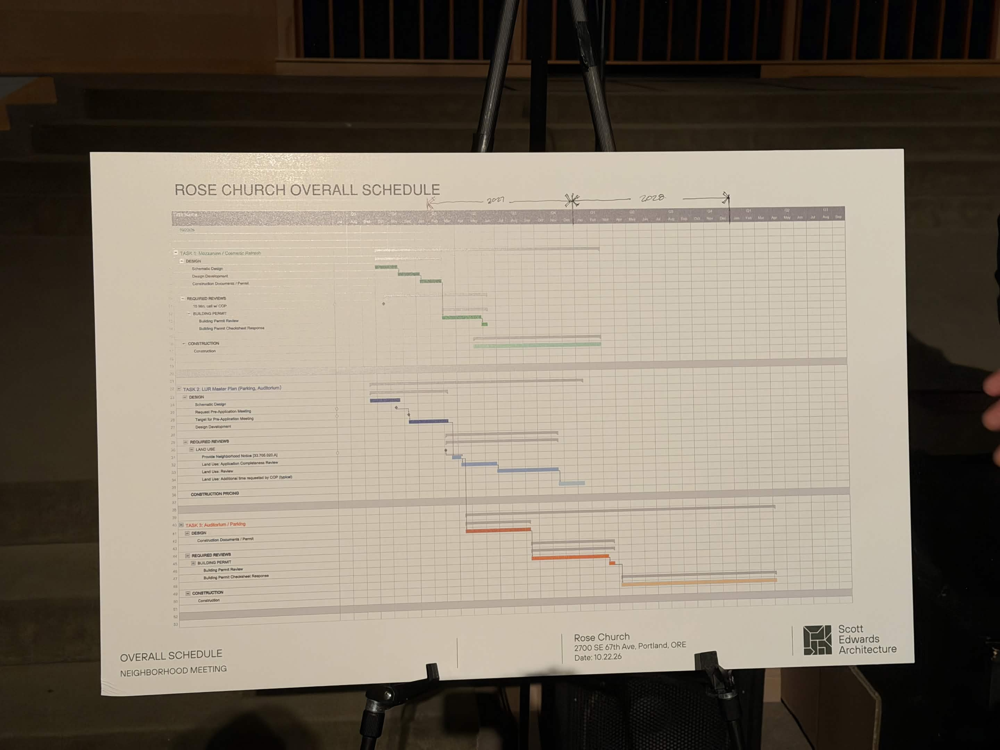

# Meeting Notes

## 2022-10-22 Rose Church + Architecture Team and South Tabor Community

### Representing Rose Church

* Andrew Damazio, Pastor, Rose Church
* Scott Edwards, Architect (and another associate presumably from the architect team).
* Todd Mobley, Traffic Engineering Service Lead
* Tim Brooks, Landscape Architect
* See [Contacts](./contacts.md)

* Key takeaways from Andrew Damazio (pastor of Rose Church) on plans for the site:
    * The intention is to keep the green space as a green space.
    * Church has drawn up plans for a 'New Gym / Auditorium'.
    * Once they submit the plans to the governing bodies this has a high likelihood of those governing bodies requiring more parking because of the increased capacity of the buildings.
    * Net: They will use the green space to fulfill parking requirements, if any. You can see this clearly on the floor plan referenced below.
* Additional statements:
    * From a legal perspective the church property changed companies from Trinity > All City > Rose Church.
    * Rose Church is a large regional church with approximately 4,000 members from up and down the I-205 corridor, from as far away as Vancouver down into the Happy Valley area, according to the pastor. Approximately 2,100 members are active participants (Sunday being the primary day for this participation.
    * The president of Warner Pacific University is a member of the church and they are in talks with the university to use university parking on Sunday mornings.
    * They will likely have 4 services on Sunday, two hours each with 40 minutes of buffer between services. The pastor expects them to have an obvious onsite presence from 7 AM - 3 PM.
    * They expect to continue golf carts and vans to shuttle members to the campus and back to their cars.
    * Rose Church is a regional (not community) church drawing members from up and down the I-205 corridor, from as far away as Vancouver down into the Happy Valley area.

