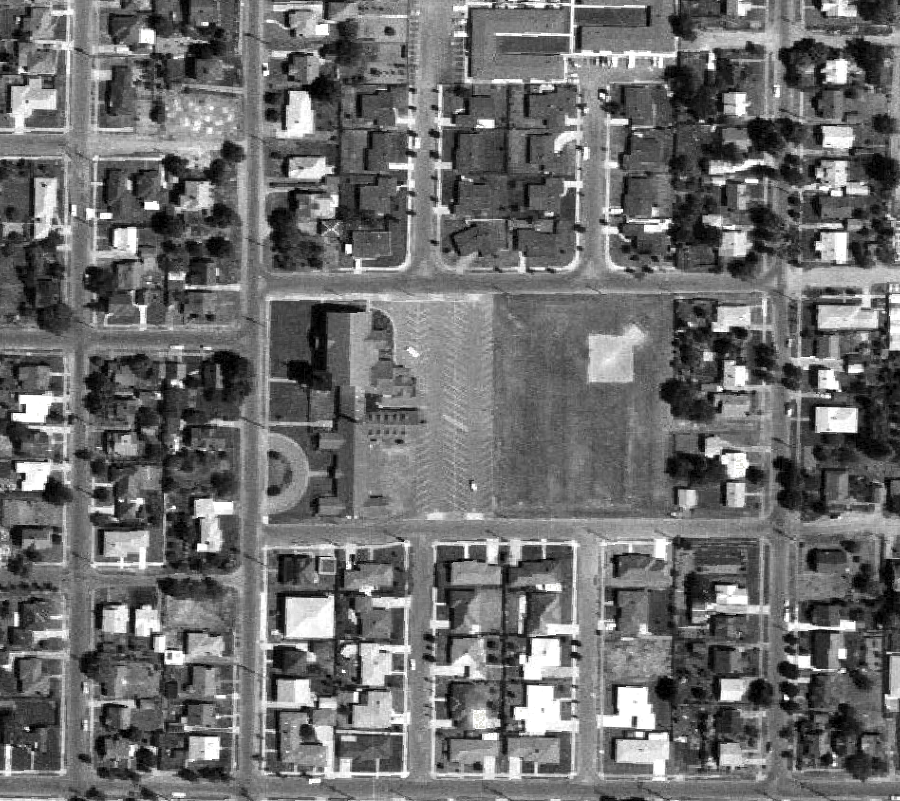
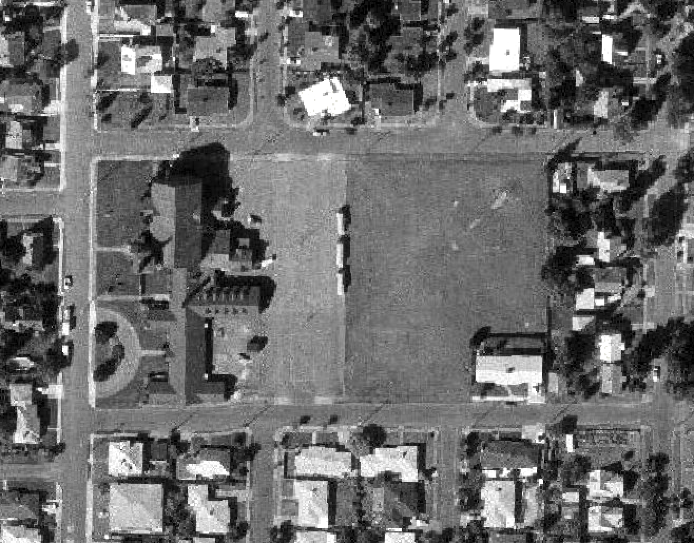
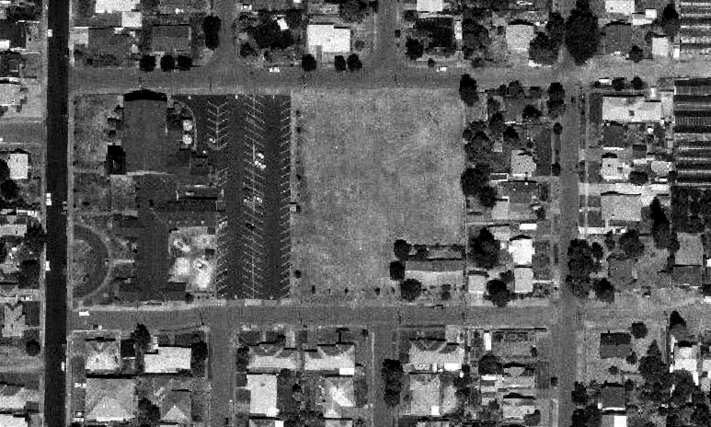
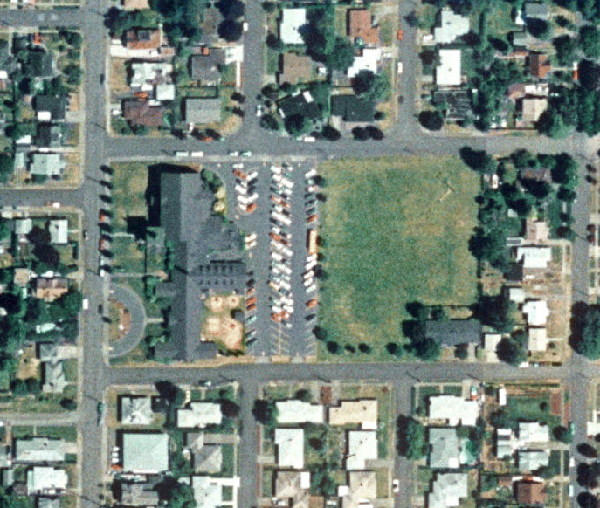

# Resources

* [Portland Maps Property Map for 2700 SE 67TH AVE Portland, OR 97206 aka Rose Church (formerly All City Church, Trinity Baptist Church)](https://www.portlandmaps.com/detail/property/2700-SE-67TH-AVE/R333123_did/)
* [Public Records for 2700 SE 67th Ave](./resources/2026-10-26-public-records-2700-67th.pdf)
* [Our Future Home at rosechurch.com](https://rosechurch.org/new-home/)
    * This web page as of 2026-10-26 archived [here](./resources/2026-10-26-Our-Future-Home-Rose-Church.pdf).
    * Usage as stated by the pastor in the video:
        * "build a new sanctuary, build a new parking lot, build a gym, build a kid's wing."
        * Full transcript: "In early April we made the announcement to step out in faith to buy a new building in Northwest Portland. And we spent a few months pursuing that building, raising money, pledging money, and our church took a huge step of faith out to pursue that building. And within a few months that door closed, and the opportunity to buy that building was no longer an option for us. Within hours of that door closing, another one opened. And now, sitting here today, we have been given a free ten acre property in Southeast Portland. One thing that we are very excited about is it's a property. It's ten acres worth of land, and there's a church building there and a parking lot. But there's also four and a half acres that we can use to dream through. And so currently we are dreaming and thinking about ways to build a new sanctuary, build a new parking lot, build a gym, build a kid's wing. There's many things that we can do now with the land, which we are so excited about. So though it's a huge miracle, we still have work to do. And so please don't hear that the building has been given for free, so we don't need to give above and beyond anymore. We still need a lot of resource to develop all of the things that we're dreaming about building. So thank you for praying with us, partnering with us. If you have not pledged yet, you have not given yet, please join us. Every single dollar is going toward this property and all the things we are dreaming to build. So thank you for giving, praying, stepping out in faith. We are so excited for what God is doing in our church, in this city, that we are, we have an amazing opportunity to further the gospel, further the kingdom through this new property that we've been given. So stay along with us, stay with the journey. We'll talk more soon."
        * "It's ten acres worth of land..." and "there's also four and a half acres": According to public records, the entire property at 2700 SE 67th Ave is 3.98 acres. See [Public Records for 2700 SE 67th Ave](./resources/2026-10-26-public-records-2700-67th.pdf)
* [First service in new sanctuary for Trinity Baptist Church from April 17 1954 in The Oregonian](./resources/1954-04-17-first-service-in-new%20sanctuary-for-trinity-baptist-church.pdf)

## Historical Aerial Photos

1960

1975

1990

1996

## Background

* [Trinity Fellowship Portland Church History](./resources/Background-Trinity-Fellowship-Portland-Church-History.pdf)

## Portland Parks and Recreation Plans and Land Acquisition Strategy

* [2020 Portland Parks And Rec Vision Plan Southeast Subsection.pdf](./resources/2020-Portland-Parks-And-Rec-Vision-Plan-Southeast-Subsection.pdf) - The Southeast section of the Parks 2020 Vision plan which established PP&R's level of service goals. Notice on p. 67 that only two areas in SE PDX are highlighted as having parkland deficiencies, one being the "area bounded by Division, Powell, and 62nd and 82nd Avenues."
* [2016 Portland Parks And Rec Land Acquisition Strategy](./resources/2016-Portland-Parks-And-Rec-Land-Acquisition-Strategy.pdf) - Outlines PP&R's land acquisition strategy. More info online at [https://www.portland.gov/parks/land-acquisition-program](https://www.portland.gov/parks/land-acquisition-program).
* [1996 South Tabor Neighborhood Plan](./resources/1996-South-Tabor-Neighborhood-Plan.pdf) - Adopted South Tabor Neighborhood Plan (from 1996, but still the most recent adopted area plan for the neighborhood). Policy 6 deals with parks and open spaces. Nothing mentioning this parcel in particular, but this plan will be a useful reference should there be a land use review for any proposed changes to the church's conditional use permit.
* [1996 Outer Southeast Community Plan.pdf](./resources/1996-Outer-Southeast-Community-Plan.pdf) - The Adopted Outer Southeast Community Plan, which includes S. Tabor. The Open Space and Environmental Policy starts on page 55 (p. 63 of the PDF). Similar to the South Tabor plan, this might shed some light on the City's adopted goals for parks and will be a useful reference in a potential land use review.
